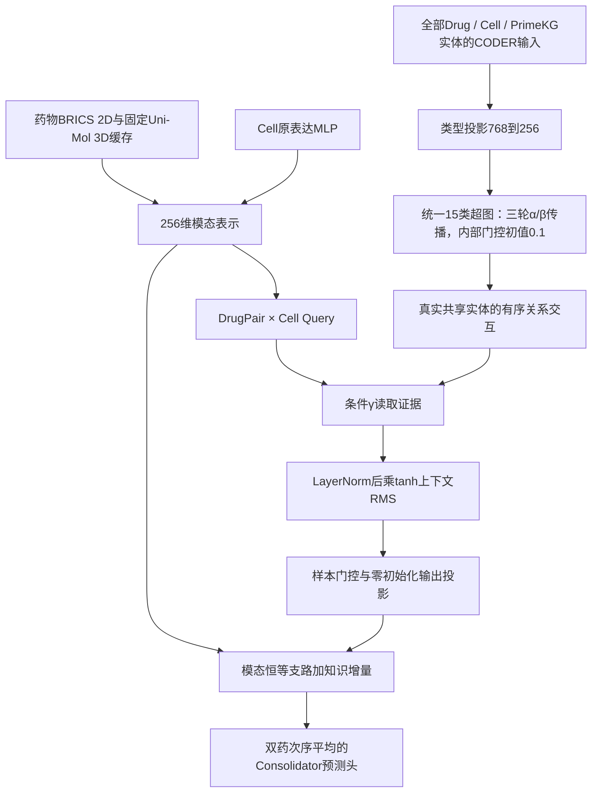

# Gemini修改稿接入与完整五折重跑

用户于2026-11-19明确要求“覆盖，你改完之后重跑一下”。当前 `dual_branch/model.py` 已使用其提供的Gemini稿并补齐运行适配；旧第一版双分支两个运行worker已停止，全部部分结果/日志和覆盖前源码保留。此前三层全衰减模型的剩余ALMANAC任务继续完成。

## 当前结构

保留原15类图、训练折正例构成的Drug–Drug–Cell协同超边、共享药物角色[0,0,2]与20%训练期协同消息Dropout。所有节点的CODER输入来自已修正大小写分词的同一缓存，Drug/Cell模态编码不初始化语义图节点。没有加入新关系、RL、Refiner或辅助目标。

内部门控0.1对应消息乘`tanh(0.1)`，**不保证消息RMS占节点RMS的10%**，也不再声称每层实际初始化恒等。外部Drug/Cell输出矩阵仍严格零初始化，因此整个模型初始化时的eval预测仍等于其模态单分支。检查另设临时归零内部门控的反事实，确认传播公式本身仍保留精确恒等支路；检查结束精确恢复0.1。

范数系数`tanh(norm(z)/sqrt(256))`等于`tanh(RMS(z))`，只保留幅度信息，不称其为已经校准的生物学置信度，也不保证训练后的知识残差幅度上限。

## 修正与实际优化器

- 删除Cell路由器重复Cell输入，使用[Cell, Knowledge]。
- 主模型明确只支持dim256；Drug2D3DEncoder和原Cell MLP均输出256，拒绝尚未贯通的dim128等配置。
- 训练入口实际调用`optimizer_param_groups`，断言所有可训练参数恰好覆盖一次；每折保存参数名、组别、学习率和衰减的`OPTIMIZER_GROUPS.json`。
- GPU浮点检查保留同输入重复前向对照、严格零的缺失3D投影项和缺失输入梯度；不因CUDA scatter的约1e-6数值差异误判为信息泄漏。
- 首步仅外部输出投影与模态/头得到监督梯度；第二步开始全部图侧模块和路由器应有非零监督梯度。所有检查与正式fold0入口门控均按该顺序核验。

本次采用用户所给Gemini方法的默认优化设置：

| 参数组 | 初始学习率 | Adam耦合L2衰减 | 参数 |
|---|---:|---:|---|
| modal_and_head | 1e-3 | 1e-4 | 2D/3D模态编码、Cell表达、预测头 |
| knowledge | 2e-3 | 1e-4 | CODER类型投影、α/β、关系交互、γ、融合路由 |
| zero_decay_gate_and_output | 2e-3 | 0 | 三轮传播门控、Drug/Cell知识输出投影 |

因此，相对第一版主学习率是10倍、知识学习率是20倍，普通衰减是原来的1/100，且门控/输出投影不衰减。这是整套新配方；性能差异不能归因于其中一个组件。没有自动扩大seed或开展调参网格。

## 数据、训练和隔离

ALMANAC和ONEIL各使用原CV1 fold0–4、training seed0。每折从新模型初始化开始，所有下游参数可训练，不读取旧协同checkpoint、不从旧检查或中途结果续训。CODER和Uni-Mol是固定离线输入；原31份输入SHA全部重新核验，实体ID/模态顺序和原十折划分复用已审计数据，无需重复编码。

仍为3000完整轮、每轮整折一次BCE更新、query_chunk1024、截断指数调度gamma0.9997/min_lr2e-6，epoch1000–3000按内部验证AUROC选checkpoint；无早停，不读取封存测试。学习率按各组独立衰减并写入history。

先各做完整图/128监督的三步CPU检查，再由原共享队列运行完整图/1024监督的GPU检查。平衡验证子集不复制稀少正例，实际数量写入CHECKS。每数据集只等待自身检查，检查通过按实测显存校准放置预算；fold0完成三次真实整折更新并确认优化器分组和监督梯度后，放行其余四折。`queue.py`是唯一GPU启动器，各目录所有本用户任务合计每卡最多2，无旧并发例外。

实时结果：`runs/dual_branch_gemini_cv5_seed0_20261119/STATUS.json`及`RESULTS.md`。

源码、输入清单、测试和调度证据：`artifacts/dual_branch_gemini_cv5_seed0_20261119/`。覆盖前源码在该目录`before_overwrite/`，旧结果仍在`runs/dual_branch_cv5_seed0_20261119`。`CURRENT_RUN.json`指向本次重跑。全部新增结果、缓存、日志、checkpoint和临时文件都在IFS2。

本次启动核验已通过：6项单元检查、两个数据集完整图CPU/GPU三步检查均通过，分组优化器和第二步全模块监督梯度已实测生效。ALMANAC fold0在GPU2、ONEIL fold0在GPU1分别完成至少18/28次真实整折更新，均从新初始化开始，CPU/GPU/正式fold0初值SHA一致。其余8折已放行到同一队列等待显存。此时尚无完整训练效果结论；可复核证据为调度目录`RERUN_VERIFIED.json`。
