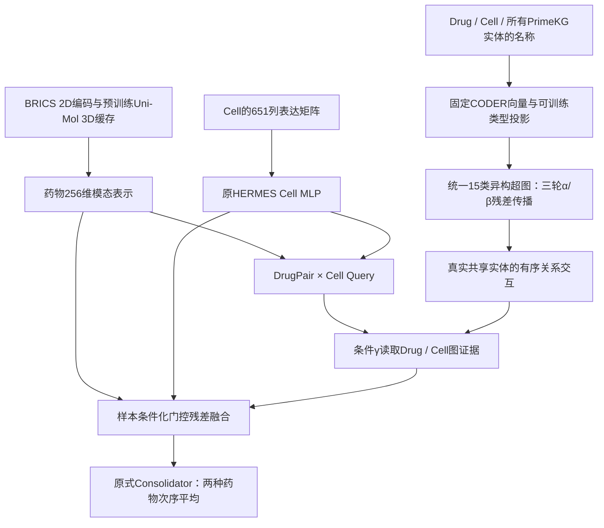

# 全节点 CODER 超图＋药物2D/3D与Cell表达双分支

历史版本说明：用户随后授权覆盖为[Gemini修正版](DUAL_BRANCH_GEMINI_V2.md)，当前`dual_branch/`已是V2。第一版源码保留于`artifacts/dual_branch_gemini_cv5_seed0_20261119/before_overwrite/`；本文保留初版设计和验证记录。

本版对应2026-11-19用户提出并要求实现的双分支方案，源码位于当前工程 `dual_branch/`。旧版模型、数据与仍在运行的五折源码保持不变。该版本是新的完整模型，不宣称已经提升协同预测，也不自动启动完整五折。



## 两条分支

图分支的 **所有节点** 都使用同一个固定 CODER checkpoint 的768维输出，经节点类型专属的 `Linear(768,256)+Tanh` 投影；Drug/Cell的2D、3D或表达编码结果不参与图节点初始化。预训练模型为 `GanjinZero/coder_eng`，固定 revision `b941ef1084ad2c8c45a13e0bfab8435091618adc`，`pooler_output + L2`，max_length128，真实截断记录在准备审计中。

Drug文本来自原药物CSV的 `name`，CID只用于实体与模态缓存对齐。Cell文本使用原表达文件中的细胞系名称，加上能严格匹配的Cellosaurus人类细胞官方疾病/组织/类型注释，不生成说明。API检索结果只保留按名称或同义词（忽略大小写与标点）唯一匹配的人类细胞，不根据第一个检索结果或模糊近似匹配猜实体。79个不同名称中75个有唯一匹配；ES-2、M14、PC-3、TK10暂有歧义或未解决，保留原名称，不添加猜测的注释。查询URL、原响应、accession和SHA保留在 `CELL_ANNOTATION_AUDIT.json` 与 `cellosaurus_raw/`。唯一向量数只是正确性审查，不能据此断言Cell语义表示已经充分。[Cellosaurus API](https://api.cellosaurus.org/)

### 首轮输入审查发现并修正的分词问题

旧本地目录有额外的 `tokenizer_config.json` 设置 `do_lower_case=False`，但固定revision官方仓库仅提供uncased词表而没有该配置。大小写不匹配使Methotrexate等名称整体变成 `[UNK]`，初次新缓存也暴露出大量重复向量。已下载并逐字节核对官方词表与本地词表相同；作者UMLS预处理默认将术语小写化。[作者预处理源码](https://github.com/GanjinZero/CODER/blob/master/pretrain/load_umls.py)

本版显式设置 `do_lower_case=True`，保留原名称作来源记录，**所有节点重新编码**，不混用旧cased外部缓存。模型权重不变，也不修改旧tokenizer目录或旧缓存。新增回归检查要求Methotrexate与methotrexate分词一致且不是UNK，并要求A549与A498编码序列不同。首次cased准备结果和当时源码冻结已保留在 `initial_cased_name_only/`，修正原因见 `TOKENIZER_CORRECTION.json`。

因此，本版相对旧模型同时改变了架构和输入预处理；将来不能把分数变化全部归因于双分支结构。公平的知识增量检验需要匹配的模态单分支参照和相同的正确输入处理。

图结构沿用当前真实关系：Drug–Protein二元事实、PPI、真实GO/通路成员集合、PrimeKG药物–疾病及疾病–蛋白、表达映射Cell–Protein，以及仅由当前fit正标签构成的 `Synergy_Hyperedge{Drug,Drug,Cell}`。共享药物角色 `[0,0,2]`、20%训练期整条协同消息Dropout继续保留。三轮α/β复用现有零门控传播公式，真实共享实体的关系交互和条件γ也直接复用现有类。

**Cell表达信息存在两处使用：** 模态分支中的表达MLP，以及图分支中已有的表达连接/边属性。全节点CODER初始化并不表示图关系完全不含表达信息；后续解释消融时必须披露这种信息重叠。表达映射不声称为测得的蛋白丰度或因果关系。验证标签不用于协同构图，原封存测试不打开。

模态分支直接调用此前审查的 `Drug2D3DEncoder`：BRICS原子/键GINE与真实片段连接，加上按相同原子位置对齐的冻结Uni-Mol表示，经可训练投影与完整片段汇聚输出256维。重复片段保留、不做Top-K。缺失3D通过覆盖率掩码保留2D路径，不用二维坐标充当三维构象。3D为计算生成的单构象，不是实验结合姿态。Cell沿用原HERMES初始化器中的表达MLP运算。所有下游参数从seed0新初始化可训练；固定的是CODER和Uni-Mol离线输入，不加载任何旧协同checkpoint。

直接复用的历史实现路径：

- `../HERMES_UniMol_StructureResidual/drug_init_2d3d/model.py`
- `../HERMES_UniMol_StructureResidual/structure_residual/model.py`
- 本工程 `global_cell/attention.py`、`structure.py` 及现有三轮传播方法。

这些文件与实际输入的SHA、源码快照保存在 `artifacts/dual_branch_v1_20261119/frozen/`。旧实现不被覆盖。

## 条件读取与融合

当前两个Drug的模态表示与Cell表达表示构造对称Query：`[DrugA+DrugB, abs(DrugA-DrugB), Cell]`。γ读取当前三个目标实体可达的关系及真实组合token，输出三个样本级知识表示。Drug共享融合参数，Cell使用独立参数；每个融合标量由自身模态表示、当前知识和Cell表示共同决定：

\[
g_i=\sigma(\mathrm{Linear}([h_i^{modal},z_i^{KG},h_C^{modal}])),\qquad
h_i^{final}=h_i^{modal}+g_iW_i\mathrm{LN}(z_i^{KG}).
\]

只有输出投影 `W_Drug/W_Cell` 初始化为0；路由器与上游网络使用普通非零初始化。初始增量严格为0，eval预测与同一个模态分支单独预测完全一致。LayerNorm只处理知识上下文，不处理模态恒等支路。**这不等于复现原完整HERMES，不包含原Refiner/相似性重构目标，也不保证训练后增量幅度有上限。** 门控数值不能直接解释成知识占比，检查记录实际增量。

由于外部输出投影和内部传播门控均从零开始，监督梯度分阶段出现：第1步输出投影与模态分支有梯度，图侧监督梯度为0；第2步图类型投影、关系交互、γ、融合路由和传播门控有梯度，α/β仍为0；第3步α/β也得到非零监督梯度。Adam耦合衰减仍可能在零监督梯度时更新非零权重，实际参数变化不能替代梯度审查。

## 入口与验证

离线输入准备：`python -B -m dual_branch.prepare`。已有同版本缓存不会被覆盖。

真实完整图CPU检查示例，在本工程目录执行：

```bash
python -B -m dual_branch.cli --dataset ONEIL --fold 0 --stage check --device cpu \
  --result-directory artifacts/dual_branch_v1_20261119/cpu_check_ONEIL \
  --expected-manifest artifacts/dual_branch_v1_20261119/frozen/manifest.json
```

检查保留完整图，仅监督/验证各取128条类别平衡样本，进行3次优化更新；不把检查指标作为预测效果。覆盖零增量恒等、开启融合后的药物交换与分块一致性、空证据、Cell改变γ、模态表达不改变语义节点初始化、Drug CODER干预、真实3D输入及缺失掩码、梯度时序和新模型实例的严格磁盘重载。

`--stage train`提供可运行的完整训练入口：原seed0各fold划分、3000完整轮、BCE、每轮整折一次更新、query_chunk1024、Adam lr1e-4/全部参数weight_decay0.01、原截断指数调度；从epoch1000按内部AUROC选checkpoint，不早停、不增加辅助目标。**本次仅实现与正确性检查，没有提交正式fit或五折。** 正式GPU检查和训练必须经过原统一 `auxiliary_jobs.json/queue.py`，所有用户任务合计每GPU最多2进程；全部新数据、日志、cache、临时文件位于IFS2。

准备、测试、源码和检查证据集中在 `artifacts/dual_branch_v1_20261119/`。`DUAL_BRANCH_VERSION.json`记录当前实现状态；现有 `CURRENT_RUN.json`继续指向正在完成的旧版五折。

本轮已完成：4项单元检查通过，ALMANAC（18201节点）与ONEIL（15203节点）的完整图CPU三步检查通过。两组初始融合增量均为0，第三步全部组件具有非零监督梯度；新实例从磁盘严格恢复checkpoint后的预测最大误差均为0。两组检查各仅用128条监督和128条验证样本，不作为效果结果。尚未进行GPU检查或正式五折训练。汇总见 `artifacts/dual_branch_v1_20261119/VALIDATION_REPORT.md`；交付源码与输入SHA复核见同目录 `DELIVERY_VERIFIED.json`。

## 2026-11-19后续训练授权

用户随后要求找空闲显存运行新版，正式范围为ALMANAC、ONEIL各seed0五折。新增 `scripts/enqueue_dual_branch_cv5.py` 只向原统一队列注册两个GPU检查与十个fit；`scripts/report_dual_branch_cv5.py` 是CPU观察器，不启动GPU worker。正式结果目录为 `runs/dual_branch_cv5_seed0_20261119`，实时状态看该目录 `STATUS.json`；旧全衰减五折保留并继续完成。

GPU检查显式使用 `--check-rows 1024`，匹配正式query chunk，不缩图。为此仅在原CLI增加检查样本数参数和reserved显存记录，不修改模型或训练公式；首版CPU检查及其源码快照保持原件，新运行使用 `artifacts/dual_branch_cv5_seed0_20261119/frozen/manifest.json`。每折重新从seed0构造，不读取GPU检查或旧实验checkpoint。

两套GPU检查通过后，观察器根据allocated及采样进程显存峰值校准放置预算并写入放行标记。各数据集先运行fold0，完成三次真实整折更新并核验零输出投影、传播gate与α/β的梯度时序，再放行其他四折。全部任务由同一个 `queue.py` 统计调度，每卡所有本用户GPU任务合计不超过2；没有空闲显存时排队，不把提交或GPU检查解释为已完成正式训练或效果提升。上文“未提交正式训练”描述初次交付时点，当前实际进度以新STATUS为准。

后续空闲显存适配：ONEIL已在卡1完成完整15203节点、1024条监督、835条实际验证样本的三步GPU检查。验证正例不足512，因此类别平衡检查仅取835条，不复制样本凑数；1024条反向传播已覆盖正式query chunk。allocated峰值3370.97MiB、reserved4684MiB、采样进程峰值5008MiB，独立新实例重载预测误差1.49e-7。缺失3D向量改动造成的token误差9.54e-7，与相同输入重复前向的误差相同；投影后缺失项和缺失输入梯度均严格为0。GPU token检查固定float32容差1e-5，CPU仍要求精确相等。两次前置技术失败（源码相对路径、GPU浮点误差精确比较）均在首次optimizer更新前发生，原日志/源码/输出保留于调度目录failed_attempts。

现由 `scripts/report_dual_branch_per_dataset.py` 复用原CPU观察器，仅将两个数据集的资源依赖解耦：每个数据集等待自身GPU检查，检查通过后按实测峰值校准其五折显存预算；fold0仍需完成3次真实整折更新并验证梯度，再放行其余折。ONEIL预留5120MiB。统一queue仍是唯一GPU启动入口，每卡本用户最多2GPU进程。ONEIL fold0已在卡1、fold1已在卡2正式更新；ALMANAC等待自身GPU检查可用显存。当前实时折数/轮次以新STATUS为准。
