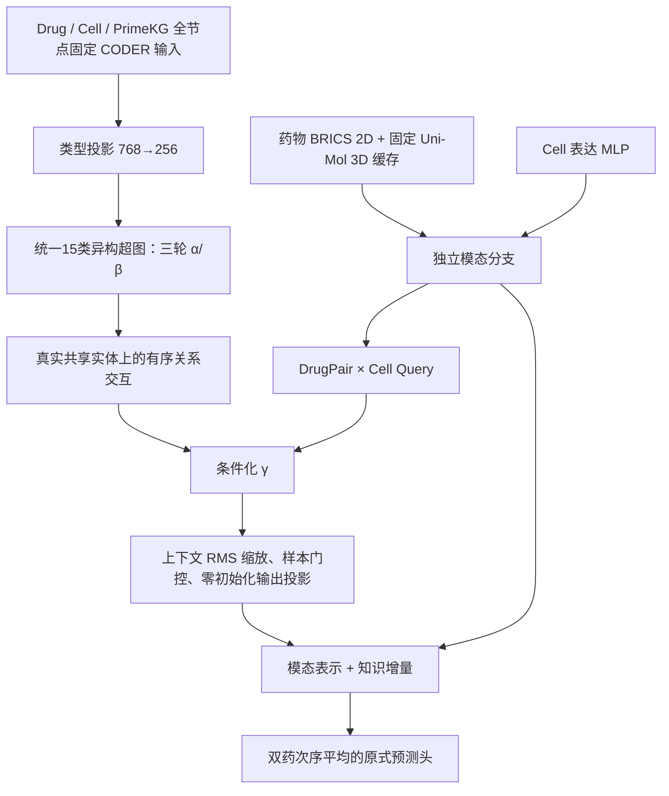

# HERMES_PrimeKG_GlobalCell

当前版本：**2026-11-19 Gemini 修正版双分支**。本仓库保存与服务器正式五折训练对应的源码；
原三层零门控版本保留在 Git 历史及旧入口中。当前模型说明见 [DUAL_BRANCH_GEMINI_V2.md](DUAL_BRANCH_GEMINI_V2.md)。

## 当前模型

- 统一图包含真实 DTI、PPI、GO/Reactome 成员关系、PrimeKG 疾病关系、Cell 表达派生连接，
  以及仅由当前训练折正例构成的 Drug–Drug–Cell 协同超边。
- 协同角色为 `[0,0,2]`，训练期在 β 后对协同边消息施加 20% Dropout，验证时关闭。
- 全节点 CODER 使用修正后的 uncased 分词。CODER/Uni-Mol 为固定离线输入；下游参数全部可训练。
- 三轮内部传播门控初值为 `0.1`，实际消息系数为 `tanh(0.1)`；外部输出投影严格零初始化。
  初始化恒等仅指模型自身的模态旁路，不代表与原完整 HERMES 等价。
- 没有 RL、SimilarityRefiner 或额外相似度重构目标；当前双分支也不包含原 HERMES Refiner。

## 固定训练配方

ALMANAC、ONEIL 各 training seed0 五折，每折完整 3000 轮，从头初始化，不加载旧协同 checkpoint。
每轮一次整训练折 BCE 更新，`query_chunk=1024`；epoch1000–3000 按内部验证 AUROC 选 checkpoint，
无早停，封存测试不参与训练或选参。正在运行不等于已证明提升，仓库不包含实时实验结果。

| 参数组 | 初始学习率 | Adam 耦合 L2 |
|---|---:|---:|
| 模态分支与预测头 | 1e-3 | 1e-4 |
| 知识表示、传播与路由 | 2e-3 | 1e-4 |
| 传播门控与知识输出投影 | 2e-3 | 0 |

截断指数调度 `gamma=0.9997`、`min_lr=2e-6`。代码实际调用参数分组，并核验全部参数恰好覆盖一次。

## 源码入口

| 文件 | 用途 |
|---|---|
| `dual_branch/model.py` | 当前 Gemini 修正版模型、融合与优化器分组 |
| `dual_branch/cli.py` | 正确性检查与正式训练 |
| `dual_branch/data.py`、`prepare.py` | 输入对齐与离线 CODER 准备 |
| `global_cell/attention.py`、`structure.py`、`synergy.py` | α/β、关系交互、条件 γ、统一构图及训练折协同边 |
| `models/zero_gated_hgnn.py` | 多轮传播基类；当前双分支将内部初始门控改为0.1 |
| `tests/test_dual_branch.py` | 融合、对称性、输入掩码与梯度时序检查 |
| `scripts/report_dual_branch_gemini_cv5.py` | 当前 CPU 观察器，复用五折报告逻辑 |
| `integration/HERMES_UniMol_StructureResidual/` | 实际调用的外部 BRICS 2D/3D 编码器源码副本 |
| `integration/mcdsp/` | 统一队列与训练桥接入口的来源副本 |
| `integration/gemini_server_launch/` | 原服务器版本迁移、检查与技术恢复脚本，仅供追溯 |

## 数据、依赖与运行范围

这是**源码同步仓库**，没有包含数据集、PrimeKG 原始数据、表达矩阵、实体向量、预训练权重、
checkpoint、日志、运行状态或结果。`ENVIRONMENT.json` 记录服务器依赖，原作者依赖见
`vendor/hermes/requirements.txt`。

代码保留服务器路径及经过审计的缓存/manifest 约定，尚未做跨机器一键复现适配。
`dual_branch/common.py` 默认从仓库并列的 `HERMES_UniMol_StructureResidual` 目录导入分子编码器；
本仓库在 `integration/` 中提供该依赖的原样源码副本，迁移时需放置到预期位置或适配路径。
准备训练还需原始划分、图和模态缓存、CODER tokenizer/权重以及相应输入与源码清单。
统一队列源码只是集成副本，不能脱离原服务器任务注册表直接用于调度。

服务器 GPU 训练始终由同一统一队列管理，各目录本用户任务合计每卡最多两个进程；
显存不足的任务等待，不因源码同步或仓库可见性调整而重启训练。

## 版本与来源

- 当前：[DUAL_BRANCH_GEMINI_V2.md](DUAL_BRANCH_GEMINI_V2.md)。
- 第一版双分支：[DUAL_BRANCH_V1.md](DUAL_BRANCH_V1.md)，其中旧零门控/全参数衰减配方不是当前版本。
- 历史三层版本：[ZERO_GATED_HGNN.md](ZERO_GATED_HGNN.md)；更早说明：[docs/HISTORY.md](docs/HISTORY.md)。
- HERMES：<https://github.com/Christina327/HERMES>，固定提交见 `vendor/hermes/PROVENANCE.json`。
- HYPER：<https://github.com/HxyScotthuang/HYPER>，辅助函数来源与作者 MIT 许可保留在 `vendor/`。
- PrimeKG 为经过审计的知识来源；表达派生连接不声称是 PrimeKG 原生事实或因果关系。

原作者源码保持字节不变。现有第三方许可与来源说明继续保留，本仓库未对全部代码重新声明统一许可证。
`SOURCE_MANIFEST.json` 记录复制来源、SHA256 和当前训练冻结源码的完整覆盖，便于核对 GitHub 与训练版本。
